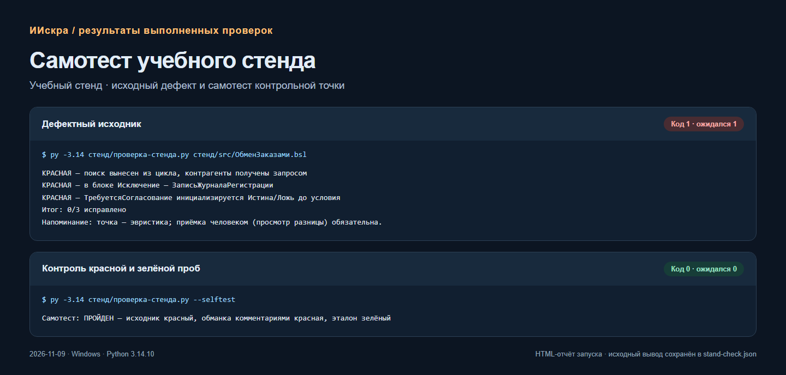
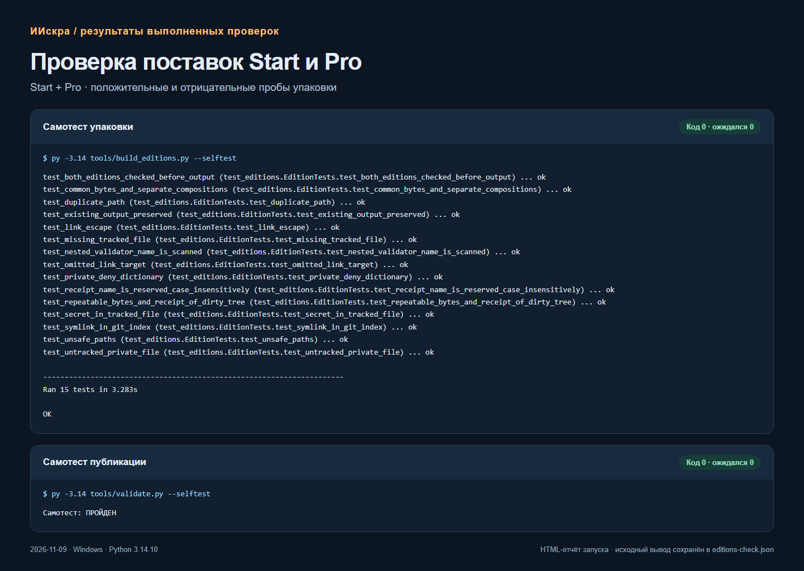

# ИИскра — ИИ-разработка в 1С с проверяемым результатом


**От первой задачи с агентом до работы с кодом, метаданными, тестами и несколькими средами.**
ИИскра даёт общий рабочий контракт для человека и агента, маршруты подключения
инструментов и контрольные точки приёмки. Основная среда — **Codex**.
Hermes и DSH подключаются к тому же канону, для Claude Code сохранён вход.

[Начать со Start](docs/быстрый-старт.md) ·
[Выбрать профиль](docs/профили-и-сборка.md) ·
[Подключить клиента](docs/клиенты.md) ·
[Документация](docs/README.md)

*Обложка — сгенерированная концептуальная иллюстрация. Отчёты выполненных
проверок и их ограничения приведены ниже.*

## Что получает разработчик

| Возможность | Практический результат |
|---|---|
| Общие правила для нескольких клиентов | Проект сохраняет условия работы при переключении среды |
| Маршруты XML, EDT и гибрида | Агент устанавливает формат и владельца источников до изменения метаданных |
| API платформы, БСП и стандарты | Решение опирается на целевую версию и условия применения |
| Несколько уровней проверки | Код, метаданные и поведение получают отдельные свидетельства |
| Диагностика инструментов | Контрольная проба различает настройку, доступность и фактическую работу |
| Контекст в файлах | Следующая сессия получает стартер, ревизию и проверяемые основания |
| Учебный стенд | Первый полный цикл можно пройти без EDT и установленной платформы |

## Выберите свою глубину

| | **ИИскра Start** | **ИИскра Pro** |
|---|---|---|
| Ваш маршрут | Освоить работу с агентом на небольшом стенде | Использовать богатый инструментарий в реальном проекте |
| В комплекте | Правила, стенд, сценарии установки, шаблоны, диагностика | Весь Start, профессиональный профиль и карта подключений |
| Первый результат | Анализ без правок, затем согласованное проверенное изменение | Паспорт окружения и задача с доказательствами работы нужных инструментов |
| Режим | Учебные остановки между этапами | Завершение задачи в согласованных границах |
| Требования качества | Общий канон | Общий канон |

Start выбран по умолчанию. Pro включается человеком явно. Оба состава собираются
из одной ревизии, общие правила идентичны. Инструкция и команды находятся в
[описании сборки](docs/профили-и-сборка.md).

## Как проходит задача


Проверка привязана к источникам, инструменту и целевой базе. Для исправления
сохраняется красная проба, затем зелёная. Ноль выполненных тестов или
непроверенный уровень явно отражаются в отчёте.

## Расширьте контур под свой проект



Внешние инструменты подключаются выборочно. Для каждого задаются условия,
безопасная проба и ожидаемое свидетельство. Полная карта Pro доступна в
`docs/pro-возможности.md` расширенной поставки и
[в репозитории](https://github.com/andromanpro/1c-ai-dev-starterpack/blob/main/docs/pro-возможности.md).

| Поставляется в ИИскре | Подключается отдельно |
|---|---|
| Правила, маршруты, шаблоны, стенд и проверки поставки | Агентская среда и модель по вашей подписке или ключу |
| Инструкции установки и контрольные пробы | EDT, CodePilot1C и другие MCP-провайдеры |
| Критерии проверки и отчёт с ограничениями | BSL LS, АПК, SonarQube, YAxUnit, Vanessa и тестовая база |

## Посмотрите на выполненные проверки



*Снимок HTML-отчёта реального запуска Python. Дефектный учебный модуль и
обманка комментариями отклоняются, встроенный текстовый эталон проходит.
Контрольная точка стенда использует эвристику по исходнику.*



*Снимок отчёта выполненных проверок упаковки. Показаны реальные результаты
положительных и отрицательных проб, включая пропущенные файлы и зависимости.*

Команды, версии и границы этих результатов — в
[матрице проверок](docs/проверенность.md). Снимки демонстрируют проверки
самого набора. Применимость внешней связки подтверждается на вашем проекте.

## Первый запуск

```bash
git clone https://github.com/andromanpro/1c-ai-dev-starterpack.git
cd 1c-ai-dev-starterpack
```

1. Откройте каталог в Codex или подключите другой [клиент](docs/клиенты.md).
2. Оставьте Start и выберите способность модели в AGENTS.md.
3. Пройдите [быстрый старт](docs/быстрый-старт.md) и две приёмки на стенде.
4. Перенесите [шаблон инструкции](templates/CLAUDE-проекта.md) в свой проект
   и заполните [паспорт окружения](templates/ОКРУЖЕНИЕ.md).

Для первого запуска нужны агент с доступом к файлам, Git и Python 3.10+.
Быстрый старт работает без платформы 1С. Сценарии полного контура ориентированы
на Windows. Модель и её оплата выбираются отдельно.

## Откройте нужный раздел

| Раздел | Что найдёте |
|---|---|
| [Документация](docs/README.md) | Рабочий цикл, отладка, контуры проверки, восстановление инструментов |
| [Клиенты](docs/клиенты.md) | Подключение Codex, Hermes, DSH и Claude, владение AGENTS.md |
| [Стенд](стенд/README.md) | Приёмка анализа и полного цикла с отрицательными пробами |
| [Профили и сборка](docs/профили-и-сборка.md) | Два состава из одного канона и проверяемые архивы |
| [Правила](AGENTS.md) | Короткое ядро и подключаемые справочники BSL и форм |
| [Каталог инструментов](docs/справочник-инструментов.md) | Внешние проекты и условия применения |
| [Испытания моделей](испытания-моделей/README.md) | Методика проверки пригодности моделей и сохранённые протоколы |
| [Проверки выпуска](docs/проверенность.md) | Выполненные команды и границы текущего изменения |

## Статус и участие

**Ранняя версия.** Публичные проверки воспроизводятся в CI. Профессиональные
интеграции описаны как подключаемые маршруты и требуют приёмки в вашей среде.
Продуктивная база запрещена общим ядром. Человек задаёт полномочия и принимает результат.
Обратная связь о первом запуске помогает уточнять маршрут.
[Сообщить о проблеме](https://github.com/andromanpro/1c-ai-dev-starterpack/issues)

## Лицензия

MIT. Внешние инструменты распространяются на своих условиях.
CodePilot1C — отдельный проект под AGPL-3.0.
