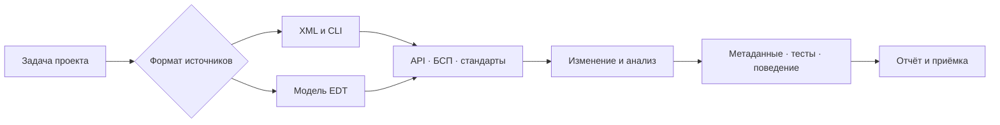

# Профессиональный контур

ИИскра Pro связывает возможности вашей среды с задачами проекта. В комплекте
поставляются маршруты, паспорт и критерии проверки. Провайдеры устанавливаются
отдельно. Подключайте те, которые нужны текущей задаче.

## Карта подключений

Все строки ниже имеют статус **маршрут описан**. Работоспособность конкретной
связки подтверждается в вашем проекте и записывается в паспорт.

| Возможность | Внешние инструменты, примеры | Безопасная проба | Подтверждение |
|---|---|---|---|
| Семантическая навигация | EDT-MCP, CodePilot1C, индекс проекта | Найти вызов известного метода и прочитать найденный участок | Проект, полнота индекса, ожидаемый вызов и его путь |
| API платформы и БСП | Справка платформы, platform-context, модули БСП | Проверить сигнатуру известного метода в целевой версии | Источник, сигнатура, совместимость и контекст выполнения |
| Стандарты 1С | v8std или доступный корпус стандартов | Найти стандарт по задаче и прочитать условия применения | Номер, версия источника и применённое требование |
| EDT и метаданные | EDT с подходящим MCP, CLI конвертации | Прочитать известный реквизит по полному пути | Объект, табличная часть, реквизит, тип и ревизия |
| Оформление и статика | bslfmt, BSL Language Server | Прогнать безопасную фикстуру с известным нарушением | Версия, число файлов, ожидаемая диагностика, повтор после исправления |
| Модульные тесты | YAxUnit, vrunner | Выполнить тест с известным результатом на копии | Число найденных и выполненных тестов, утверждения и цель |
| Сценарии интерфейса | Vanessa Automation, тестовый клиент | Открыть форму и выполнить согласованный сценарий | Фактические шаги, эффект, данные и снимки тестового клиента |
| Отладка и скорость | Журнал регистрации, отладчик, профилировщик | Воспроизвести дефект или замерить один сценарий | Условия, конкурирующие гипотезы, измерения до и после |
| Выпуск и качество | АПК, SonarQube, аудит прав | Проверить область и известное замечание | Версии правил, число объектов, ограничения покрытия и исключения |
| Независимое ревью | Другая модель или агент по разрешению | Дать ограниченный пакет с источниками и сохранить полный ответ | Модель, объём передачи, канал оплаты, находки и их верификация |

Универсальное имя операции MCP здесь не фиксируется. Сначала получите список
доступных операций текущего провайдера и проверьте применимость к проекту.
При отсутствии нужного инструмента укажите непроверенную часть и способ её приёмки.

## Первый прогон Pro

1. Выберите Pro в инструкции проекта и заполните паспорт окружения.
2. Установите формат исходников и владельца изменений.
3. Выберите одну необходимую возможность, проверьте её доступность контрольной пробой.
4. Выполните согласованную небольшую задачу, сохранив отрицательную и положительную проверки.
5. Покажите diff, отчёт и непроверенные уровни. Для живой 1С требуется разрешённая копия базы.

Пример использования без установки 1С — проверить сборщик двух поставок, изменить
состав на временной фикстуре и убедиться, что пропущенная зависимость отклоняется.
Это проверка упаковки. Проверку поведения 1С проводите отдельным сценарием.

## Что подтверждено в этом изменении

Публичные контрольные точки и упаковка проверяются воспроизводимыми командами
из [описания сборки](профили-и-сборка.md). Реальные результаты приведены в
[отчёте выпуска](проверенность.md). Живые связки Codex/Hermes/DSH с EDT,
АПК, SonarQube, YAxUnit и Vanessa в рамках этого изменения не запускались.

[Общее ядро](../AGENTS.md) · [Профиль Pro](../profiles/pro.md) ·
[Паспорт окружения](../templates/ОКРУЖЕНИЕ.md)
